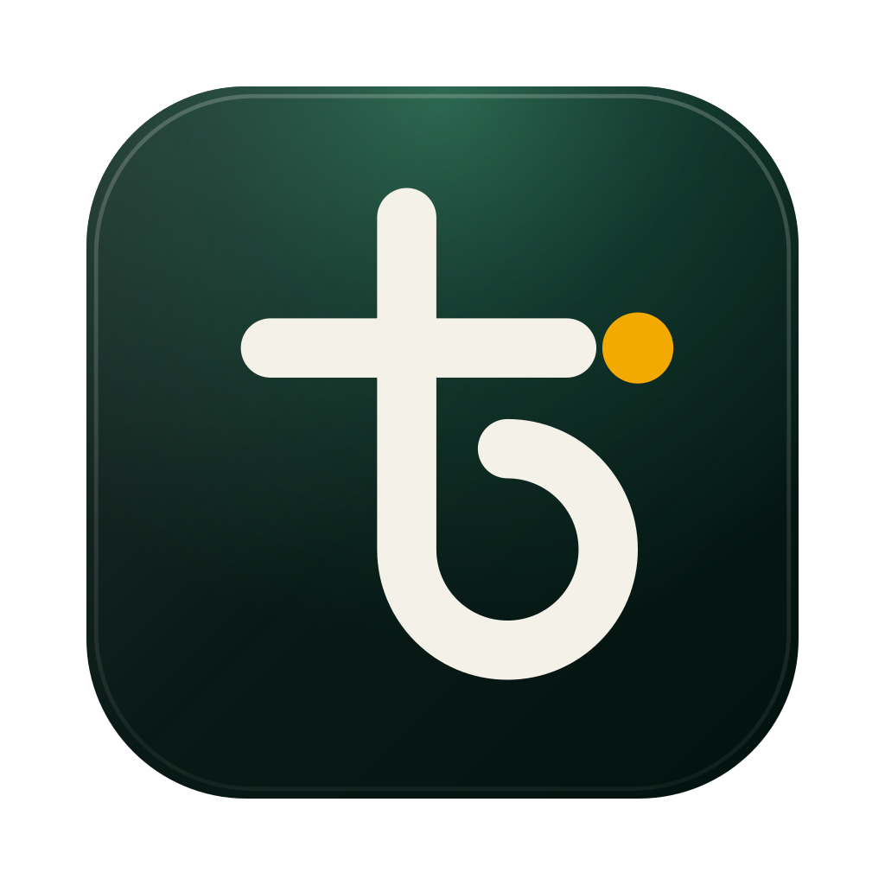

  

# Talia Desktop

*21st Capital's desktop app for Talia Vaults, on Mac and Windows.*

Talia Desktop is [Liana](https://github.com/wizardsardine/liana), the Bitcoin wallet made by
[Wizardsardine](https://wizardsardine.com), with 21st Capital's Talia design: name, logo, colours,
fonts and icons, and the Talia vault graph. Wallets, signing devices and the wallet folder work exactly as in Liana, so a vault made in
Liana opens in Talia Desktop and the other way round.

- Talia for iPhone: [21st-Capital/talia](https://github.com/21st-Capital/talia)
- What this fork changes, and how it follows each Liana release: [contrib/talia/README.md](contrib/talia/README.md)
- Licence: BSD 3-Clause, the same as Liana. Wizardsardine's copyright notice is kept in
  [LICENCE](LICENCE), next to ours.

Downloads will be published under Releases.

---

*The original Liana README follows.*

  

# Liana

*The missing safety net for your bitcoins*.

## About

Liana is a simple Bitcoin wallet. Like other Bitcoin wallets you have one key which can spend the
funds in the wallet immediately. Unlike other wallets, Liana lets you in addition specify one key
which can only spend the coins after the wallet has been inactive for some time.

We refer to these as the primary spending path (always accessible) and the recovery path (only
available after some time of inactivity). You may have more than one key in either the primary or
the recovery path (multisig). You may have more than one recovery path.

Here is an example of a Liana wallet configuration:
- Wallet Manager's key (can always spend)
- Any 2 keys from the owner's spouse and two kids (after 1 year)
- A third party, in case [all else failed](https://wizardsardine.com/liana/plans#section-safety-net)
  (after 1 year and 3 months)

The lockup period is enforced onchain by the Bitcoin network. This is achieved by leveraging
timelock capabilities of Bitcoin smart contracts (Script).

Liana can be used for **trustless inheritance**, **loss protection** or **safer backups**. Visit
[our website](https://wizardsardine.com/liana) for more information.

## Usage

Liana is available on Windows, Mac and Linux. To install and start using it see
[`doc/USAGE.md`](doc/USAGE.md). A more accessible version of Liana is also available as a web
application [here](https://lianalite.com/).

If you just want to quickly try out Liana on Bitcoin Signet, see [`doc/TRY.md`](doc/TRY.md).

## Hacking on Liana

Liana is an open source project. It is [hosted at Github](https://github.com/wizardsardine/liana).
Contributions are very welcome. See [here](CONTRIBUTING.md) for guidelines. Most regular
contributors hang out on [our Discord](https://discord.gg/9rAqZHwkv6). Join us there if you have any
question about contributing.

Liana is separated in two main components: the daemon and the Graphical User Interface.

#### Liana daemon

The daemon contains the core logic of the wallet. It is both a library (a Rust crate) that exposes a
command interface and a standalone UNIX daemon that exposes a JSONRPC API through a Unix Domain
Socket.

The code for the daemon can be found in the [`liana`](liana) folder.

#### Liana GUI

The GUI contains both an installer that guides a user through setting up a Liana wallet, as well as
a graphical interface to the daemon using the [`iced`](https://github.com/iced-rs/iced/) library.

The code for the GUI can be found in the [`liana-gui`](liana-gui) folder.

## Security

See [`SECURITY.md`](SECURITY.md) for details about reporting a security vulnerability or any bug
that could potentially impact the security of users' funds.

## License

Released under the BSD 3-Clause Licence. See the [LICENCE](LICENCE) file.
